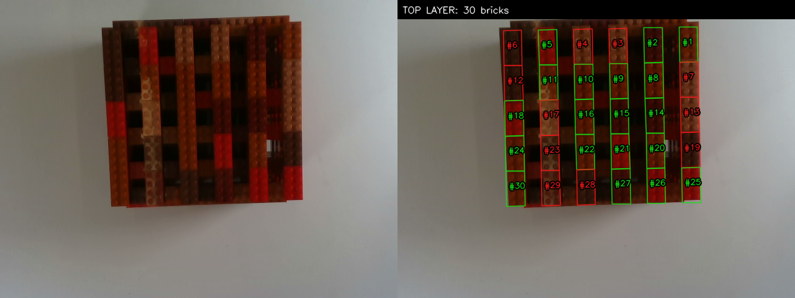
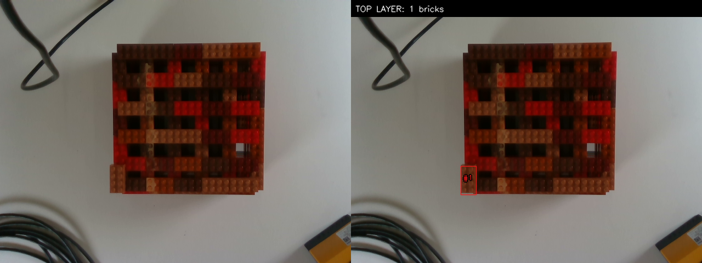

# Top-layer brick quality classifier

This folder contains the standalone good/bad classifier that runs after the
RGB-D top-layer detector. Segmentation and classification remain independent:
the classifier never loads SAM, never changes the detected boxes, and can run
on the CPU using saved `top_boxes.json` files.

The current quality rule is based on the known LEGO colours:

| LEGO colour | Element | Quality |
|---|---:|---|
| Red | 300121 | Good |
| Dark red | 6117418 | Good |
| Dark orange | 6487946 | Good |
| Medium nougat | 6135191 | Bad |
| Reddish brown | 4211201 | Bad |

## Architecture

```text
RGB frame + top_boxes.json
            │
            ├── Estimate white balance from neutral table pixels
            │
            └── For every oriented top-layer box
                    │
                    ├── Rasterize the oriented rectangle
                    ├── Erode 12% from its boundary
                    ├── Remove dark shadows and bright highlights
                    └── Measure robust median CIELAB colour
                                      │
                         Bounded scene Lab-offset correction
                                      │
                         Weighted distance to five prototypes
                                      │
                              LEGO colour class
                                      │
                   ┌──────────────────┴──────────────────┐
          medium nougat / reddish brown        remaining colours
                       BAD                          GOOD
                    red box                     green box
```

### Reliable colour extraction

The oriented box is eroded before measurement so neighbouring bricks, gaps,
and lower layers do not contaminate the colour. The darkest 15% and brightest
10% of interior pixels are removed to suppress stud shadows and specular
highlights. The median of the remaining pixels is considerably more stable
than a mean over the complete bounding box.

### Illumination correction

Neutral, moderately exposed pixels outside all brick boxes estimate the table
colour. Conservative RGB gains make this reference neutral. A second bounded
Lab offset is estimated jointly from all bricks in the frame. Lightness may
adapt more than chroma, preventing exposure changes from erasing actual colour
differences.

### Prototype decision

The classifier compares each corrected Lab measurement with five
camera-calibrated colour prototypes. The distance weights are:

```text
L*: 0.45    a*: 1.0    b*: 1.0
```

The nearest prototype supplies the colour and therefore the good/bad result.
The JSON output also retains the second-best class, distance margin, all class
distances, and a high/low confidence flag. The visualization always uses the
requested binary decision: green for good and red for bad.

## Run

The script requires Python, NumPy, Pillow, and OpenCV. The existing `sam3`
environment contains these dependencies, but the classifier itself does not
load SAM or require a GPU.

From the repository root:

```bash
conda run -n sam3 python classifier/classify_top_brick_quality.py \
  perception/sam3_detection/results_rgbd_topplane_v2 \
  --out classifier/results_rgbd_quality_v1
```

Important options:

| Option | Default | Meaning |
|---|---:|---|
| `--erosion-fraction` | 0.12 | fraction of the short brick side removed at the boundary |
| `--min-pixels` | 80 | minimum reliable pixels before falling back to the complete box |
| `--max-distance` | 35 | maximum weighted prototype distance for high confidence |
| `--min-margin` | 4 | required separation from the second-best class |

## Learned colour model

[`colour_model.py`](colour_model.py) trains a replacement for the fixed
prototypes from the labelled single-brick dataset in
`data/brick_dataset_extracted` (224 bricks, five colours). The trained model is
[`colour_model.json`](colour_model.json); running it needs only NumPy.

- Each brick is measured exactly as above (white balance, eroded box, robust
  median Lab), then described by three features that transfer from isolated
  bricks to stacks: Lab hue angle, lightness / table lightness, and chroma /
  table lightness.
- Linear discriminant analysis with equal class priors gives a probability per
  colour. Below `threshold` (default 0.7) the brick is low confidence.
- In frames with at least 10 boxes, a bounded per-frame hue shift and
  lightness/chroma scale is fitted so the bricks best match the colour
  clusters. This absorbs auto-exposure drift between captures and is saved as
  `scene_feature_transform`. Smaller frames are not corrected.

Train (prints accuracy with a random split, which is optimistic, and with each
lighting condition held out, which is pessimistic, plus confusion matrices):

```bash
conda run -n sam3 python classifier/colour_model.py \
  --dataset data/brick_dataset_extracted --out classifier/colour_model.json
```

Classify with it:

```bash
conda run -n sam3 python classifier/classify_top_brick_quality.py \
  <segmentation results> --out <out> --colour-model classifier/colour_model.json
```

Without `--colour-model` the fixed prototypes below are used, unchanged.
`run_pipeline_classifier.sh` uses the model by default (see
[`pipeline_classifier/README.md`](../pipeline_classifier/README.md)).

Optional second opinion: [`claude_second_opinion.py`](claude_second_opinion.py) asks
Claude (vision, needs the `anthropic` package and an API key) for each final brick's
colour without showing it the classifier's answer. Disagreements lower the brick's
colour confidence; colours and geometry are never overwritten. See
[`pipeline_classifier/README.md`](../pipeline_classifier/README.md#second-opinion-from-claude-optional).

Known weaknesses: strong glare washes light bricks (especially medium nougat)
out to grey-white and they can be misclassified; the dataset has no nougat
samples under strong glare. Diffuse lighting or a lower fixed exposure helps
most.

## Output

The complete 69-recording result set is stored in
[`results_rgbd_quality_v1/`](results_rgbd_quality_v1/), covering all 32
`data3` and 37 `data4` recordings.

Each `<dataset>/<recording>/<frame>/` folder contains:

| File | Content |
|---|---|
| `quality_result.png` | RGB image with thin red/green oriented boxes |
| `quality_comparison.png` | original image and classification side by side |
| `quality_boxes.json` | classification, confidence, Lab values, distances, white balance, and original box geometry |

The result root also contains `summary.json` and `summary.csv` with per-frame
brick, good, bad, and low-confidence counts.

## Examples

Dense 30-brick layer from `data4`:



Single remaining top brick from `data3`:



## Limitations

The prototype method is a deterministic reference-colour classifier; the
learned colour model above is trained on the labelled single-brick dataset. Confidence values indicate ambiguity but
are not measured probabilities. Fixed exposure and white balance are still
recommended. If the camera, illumination, or physical brick batch changes
substantially, recalibrate the five Lab prototypes before relying on the
quality decision for robotic sorting.
