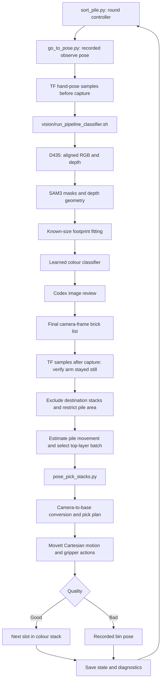

# FR3 pile picking and colour sorting: technical documentation

Documented on **27 October 2026** from the local implementation and configuration.
This guide describes the working application: the ROS 2 package in
`src/fr3_pose_pick/` and its camera pipeline in `vision/`.

The final operating command is:

```bash
cd ~/Documents/Hackathon/fr3_lego_sorter
ros2 run fr3_pose_pick sort_pile.py --config src/fr3_pose_pick/config/pose_pick.yaml
```

The run settings (Codex review, 15 bricks per scan, 10 recoverable failures in a
row, no window) are the `sort_pile:` section of the YAML; see
[Command-line options](#105-command-line-options).

The robot and ROS environment must already be running; the complete startup
sequence is in [Operating the system](#10-operating-the-system).

### Contents

- [What the system does](#1-what-the-system-does)
- [Architecture and source map](#2-architecture-and-responsibility-boundaries)
- [Technical stack](#3-technical-stack)
- [Code workflow and execution sequence](#4-code-workflow-and-execution-sequence)
- [Perception methodology](#5-perception-methodology)
- [Coordinates, calibration and height](#6-coordinates-calibration-and-grasp-height)
- [Picking, motion and feedback](#7-picking-motion-and-feedback)
- [Destination layout and placement](#8-destination-layout-and-placement)
- [Configuration snapshot](#9-configuration-snapshot)
- [Operating the system](#10-operating-the-system)
- [Monitoring and diagnosis](#11-monitoring-saved-artifacts-and-failure-diagnosis)
- [Concepts and limits](#12-concepts-assumptions-and-current-limits)
- [Further references](#13-further-implementation-references)

## 1. What the system does

The application repeatedly observes a pile of LEGO bricks with a wrist-mounted
RealSense D435, identifies accessible top-layer bricks, estimates their positions
and angles, classifies their colours, and moves them with a Franka FR3 and Franka
Hand. Good bricks go to a separate stack for each colour. Bad bricks go to a
recorded bin pose. After a small batch, the robot returns to the observation pose
and takes another image, exposing and processing progressively lower layers.

The current task defines quality through colour:

| Colour identifier | Quality | Destination |
|---|---|---|
| `red` | Good (`G`) | Red stack |
| `dark_red` | Good (`G`) | Dark-red stack |
| `dark_orange` | Good (`G`) | Dark-orange stack |
| `medium_nougat` | Bad (`B`) | Bin |
| `reddish_brown` | Bad (`B`) | Bin |

“Bad” is a task-specific colour category. The implementation does not inspect
cracks, damage, manufacturing defects, or mechanical quality.

The default `stacks` mode uses two bricks per scan, reducing permanently to one
per scan if the measured pile displacement exceeds 2 mm. Two consecutive scans
with no eligible pile detections end the run successfully; the default upper
limit is 40 rounds. Success means the perception loop no longer reports pile
bricks after filtering. It is not an independent physical inventory check.

## 2. Architecture and responsibility boundaries



There are two Python environments:

- **Robot execution:** ROS 2 Humble Python, `rclpy`, TF, MoveIt interfaces and
  Franka gripper actions in `src/fr3_pose_pick/`.
- **Perception:** the `sam3` Conda environment for `vision/`, launched through
  a shell script. Its default interpreter is
  `$HOME/miniconda3/envs/sam3/bin/python`; the `PY` environment variable overrides it.

The final command does **not** require starting `brick_publisher.py`,
`stack_listener.py`, or `palletize_listener.py` as separate processes. It imports
their parsing, filtering and command-building helpers, then calls the perception
and pick programs directly as subprocesses. `/brick_poses` belongs to the
alternative publisher/listener workflow, not the active transport in this command.

The perception-to-robot interface is currently the pipeline's final **printed pose
list**, parsed from subprocess output. JSON files hold richer detection details
and provide the GUI images. ROS services, actions and TF handle robot execution.

### Main source files

Paths below are relative to the repository root.

| File | Responsibility |
|---|---|
| [sort_pile.py](src/fr3_pose_pick/scripts/sort_pile.py) | Repeated observe–scan–pick loop, pile filtering, batch limit, shift detection and termination |
| [brick_publisher.py](src/fr3_pose_pick/scripts/brick_publisher.py) | Shared pipeline launcher, pose-line parser and fresh TF sampling |
| [palletize_listener.py](src/fr3_pose_pick/scripts/palletize_listener.py) | Shared camera-depth top-layer filter and row command builder |
| [stack_listener.py](src/fr3_pose_pick/scripts/stack_listener.py) | Builds stacking arguments with colour and the image's hand pose |
| [pose_pick_stacks.py](src/fr3_pose_pick/scripts/pose_pick_stacks.py) | Destination selection, stack layout, capacity and persistent occupancy |
| [pose_pick_palletize.py](src/fr3_pose_pick/scripts/pose_pick_palletize.py) | Shared placement modes and bin handling; optional row mode |
| [pose_pick_auto.py](src/fr3_pose_pick/scripts/pose_pick_auto.py) | Autonomous grasp checks, measured placement alignment and diagnostics |
| [pose_pick.py](src/fr3_pose_pick/scripts/pose_pick.py) | Camera input resolution, height model and basic pick/place mission |
| [camera_frame.py](src/fr3_pose_pick/scripts/camera_frame.py) | Hand-eye transform and camera-angle conversion |
| [smooth_motion.py](src/fr3_pose_pick/scripts/smooth_motion.py) | Cartesian planning, trajectory execution, wrist choice, gripper and planning scene |
| [trajectory_smoothing.py](src/fr3_pose_pick/scripts/trajectory_smoothing.py) | Pure NumPy/SciPy kinematics, smoothing and trajectory timing |
| [go_to_pose.py](src/fr3_pose_pick/scripts/go_to_pose.py) | Motion to a named observation pose |
| [record_pose.py](src/fr3_pose_pick/scripts/record_pose.py) | Records named hand poses from TF |
| [sort_gui.py](src/fr3_pose_pick/scripts/sort_gui.py) | Last-scan image with per-brick progress overlays |
| [pose_pick.yaml](src/fr3_pose_pick/config/pose_pick.yaml) | Geometry, motion, gripper, calibration and sorting parameters |
| [poses.yaml](src/fr3_pose_pick/config/poses.yaml) | Observation pose, bin pose and colour-stack centres |
| [run_pipeline_classifier.py](vision/run_pipeline_classifier.py) | Capture, normal geometry, standalone classification, optional review and final pose output |

The mission classes reuse one another through the following inheritance chain:

```text
pose_pick.Mission
  └── pose_pick_auto.AutoMission
        └── pose_pick_palletize.PalletizeMission
              └── pose_pick_stacks.StackMission
```

The wrappers temporarily replace `pose_pick.Mission`, arguments and the initial
confirmation handler to run the shared mission with stacking behavior. This is
Python-level reuse; these are not four separately running ROS control nodes.

## 3. Technical stack

| Layer | Technology used | Purpose |
|---|---|---|
| Manipulator | Franka Research 3, seven joints | Reach grasp and placement poses |
| End effector | Franka Hand with configured fingertip geometry | Parallel-jaw grasp across the brick's short side |
| Camera | Wrist-mounted Intel RealSense D435 | Colour image and aligned depth |
| Middleware | ROS 2 Humble, `rclpy`, DDS | Robot nodes, services, actions and state |
| Robot support | `franka_ros2`, `libfranka`, robot descriptions, `ros2_control` | Hardware integration, controllers and robot model |
| Motion | MoveIt 2 Cartesian-path service and trajectory action | Compute collision-checked lines and execute timed joint trajectories |
| Coordinates | TF2, homogeneous transforms, quaternions | Relate camera observations to the robot base |
| Perception model | SAM3 through Hugging Face Transformers and PyTorch | Segment candidate LEGO instances using the `lego brick` prompt |
| Model execution | CUDA when available, CPU fallback | SAM3 inference; bfloat16 on supported CUDA hardware, float32 otherwise |
| Camera access | `pyrealsense2` | Configure streams, align depth to colour, save frames and intrinsics |
| Image processing | OpenCV, NumPy, Pillow | Masks, contours, colour measurements, previews and GUI |
| Numerical methods | NumPy and SciPy | Rotations, SVD, kinematics, damped least squares and interpolation |
| Colour model | Locally implemented linear discriminant analysis (LDA) | Predict one of five known colours from measured features |
| Image review | Codex CLI via `codex exec` | Review colours and invalid detections using images and structured output |
| Configuration and records | YAML, JSON, CSV, PNG | Parameters, calibration, occupancy, logs and perception artifacts |
| Build and inspection | `ament_cmake`, CMake, colcon, RViz | Install scripts/configuration and inspect the robot/planning scene |

Package dependencies are declared in
[package.xml](src/fr3_pose_pick/package.xml). Perception dependencies live in the
sibling environment and are not all installed by building the ROS package. The
default GUI also imports OpenCV from the robot-side Python environment; use
`--no-gui` when running without that display path.

## 4. Code workflow and execution sequence

The final command follows this workflow:

```text
START
  → Load task configuration and recorded poses
  → Check observation pose, pipeline path and colour-stack layout
  → Start ROS TF listener and optional progress window
  → Move to observation pose
  → Capture RGB-D and run detection → classification → Codex review
  → Verify that the hand stayed still and parse the final brick list
  → Exclude destination stacks and anything outside the configured pile area
  → Check for an empty pile or estimate movement since the previous scan
  → Keep only the top layer and colours with available destinations
  → Select a small batch
  → For each brick: transform pose → pick → verify hold → place → save
  → Return to observation and repeat
  → Finish after consecutive empty scans, or stop on failure/round limit
```

### Workflow from the terminal command to the robot

| Step | Code entry point | Input → output / next action |
|---|---|---|
| 1. Start the application | `sort_pile.main()` | CLI arguments → sorter options plus pipeline arguments; `--review codex` is forwarded and `--auto-capture` is added |
| 2. Load the layout | `record_pose.load_poses()` and `pose_pick_stacks.stacks_from_config()` | YAML configuration and named poses → observation pose and validated colour destinations |
| 3. Establish state access | ROS node `sort_pile`, TF `Buffer` / `TransformListener` | Robot transform stream → hand-pose buffer, maintained by a background executor thread |
| 4. Observe | Subprocess `go_to_pose.py observe` | Recorded pose → collision-checked robot motion and arrival check |
| 5. Acquire and interpret a scan | `sort_pile.look()` → `brick_publisher.run_pipeline()` | Fresh TF samples and perception output → `bricks`, image-time `ee_pose`, final result folder |
| 6. Restrict the source | `on_the_pile()` → `to_base()` | Camera poses and hand-eye calibration → pile detections separated from destination/area exclusions |
| 7. Adapt to pile movement | `pile_shift()` | Previous unpicked positions and current positions → median displacement; batch limit may become one |
| 8. Select work | `palletize_listener.top_layer_only()` → `pickable()` | Pile detections → accessible top-layer candidates with destinations, capped by the batch limit |
| 9. Dispatch the batch | `stack_listener.command()` → `run_pick()` | Selected brick records → arguments for the `pose_pick_stacks.py` subprocess |
| 10. Allocate each destination | `pose_pick_stacks.main()` → `slot()` / `release_z()` | Quality, colour and saved occupancy → next stack slot/release height or recorded bin pose |
| 11. Execute each mission | `pose_pick.main()` using `StackMission` | Camera pose and destination → validated pick plan, arm/gripper actions and measured feedback |
| 12. Persist and continue | `StackMission.record_stack()` and `AutoMission.save_log()` | Successful stack release → occupancy update; mission outcome → diagnostic log; batch result → next round or stop |

For `--mode row`, step 9 uses the row command builder and
`pose_pick_palletize.py` instead. The documented operating command takes the
default `stacks` branch.

### Function-call path through perception and manipulation

```text
ros2 run fr3_pose_pick sort_pile.py ...
└── sort_pile.main()
    ├── load YAML; validate named poses and stack layout; initialize ROS/GUI
    └── repeat observation rounds
        ├── subprocess: go_to_pose.py observe
        ├── look()
        │   ├── hand_samples() → pose_record()               [before scan]
        │   ├── run_pipeline()
        │   │   └── subprocess: vision/run_pipeline_classifier.sh
        │   │       └── run_pipeline_classifier.py
        │   │           ├── capture_d435.py                  [new RGB-D]
        │   │           ├── top_layer_bricks.py             [SAM3 + geometry]
        │   │           ├── pipeline_classifier/reclassify.py
        │   │           │   └── standalone classifier + learned colour model
        │   │           ├── claude_review.review(backend="codex")
        │   │           │   └── codex exec → merge review into detections
        │   │           └── print final brick poses and result folder
        │   ├── hand_samples() → pose_record()               [after scan]
        │   └── check pose consistency → parse_bricks()
        ├── on_the_pile() → to_base()
        ├── pile_shift() → top_layer_only() → pickable() → cap batch
        └── stack_listener.command() → run_pick()
            └── subprocess: pose_pick_stacks.py
                ├── load saved occupancy; check batch capacity/bin pose
                └── for each brick
                    ├── allocate stack slot or bin destination
                    └── pose_pick.main() with Mission replaced by StackMission
                        ├── resolve_camera_target() → plan_pick()
                        └── mission.run() → inherited pick/place sequence
                            ├── Mover.move() → plan_line()
                            │   ├── MoveIt compute_cartesian_path
                            │   ├── smooth_trajectory() or fallback timing
                            │   └── MoveIt execute_trajectory
                            ├── Mover.hand() → Franka move/grasp actions
                            ├── check_grasp() after closing and lifting
                            ├── place_brick() → stack drop or bin release
                            ├── record_stack() after a good brick's release
                            └── save_log()
```

The tree shows logical ownership. The arm and gripper calls are interleaved in
the mission's physical sequence: **open → hover → approach → descend → close →
check → lift → check → carry → align/place → open → back off**. The
`Mover.move()` branch runs for each arm segment, rather than planning the entire
sorting task in one call. A failed grasp check stops the sequence before later
carry/place actions.

### Data passed between stages

The internal scan message has the following structure; uppercase coordinates
below are placeholders describing fields, not a runnable robot target:

```text
message = {
    "run": final_result_folder,
    "ee_pose": [X_hand, Y_hand, Z_hand, QX, QY, QZ, QW],
    "bricks": [
        {
            "id": detection_id,
            "colour": "red",
            "quality": "good",
            "label": "G",
            "camera_xyz": [X_camera, Y_camera, Z_camera],
            "angle_deg": long_side_image_angle,
            "note": optional_pipeline_note
        },
        ...
    ]
}
```

`ee_pose` is the hand pose associated with the image, in the robot base frame;
`camera_xyz` is each brick's top-face centre in the camera frame. They must remain
paired. The batch command carries the pose as `--ee-pose` and each selected brick
as `--brick`. The executor then converts camera coordinates to base coordinates
for motion. Detection IDs identify bricks within a scan; stack slots are allocated
separately from saved destination occupancy.

Three kinds of state have different lifetimes:

- **Per scan:** image, detections, image-time hand pose and result folder.
- **Per sorter run:** empty-scan count, completed-batch brick count, previous
  unpicked positions and the adaptive batch limit.
- **Across restarts:** named poses, calibration, saved stack occupancy and
  diagnostic files. Restarting the sorter clears its in-memory scan counters,
  while the destination occupancy remains on disk.

### Round decisions and stop conditions

| Condition in the workflow | Action |
|---|---|
| No pile detections after area/destination filtering | Increment the empty-scan count; rescan until the configured count is reached |
| A nonempty scan follows an empty scan | Reset the consecutive-empty count to zero |
| Estimated pile shift exceeds the threshold | Use one brick per scan for all remaining rounds of this run |
| Top-layer good colour has no stack | Leave that brick on the pile; stop if there is no other pickable top-layer brick |
| Batch contains a good brick | Allocate its next colour-stack slot and validate capacity |
| Batch contains a bad brick | Use the recorded bin destination and validate it before executing the batch |
| A brick is released onto a stack | Save its occupied slot before backing off |
| Whole batch succeeds | Update the outer moved count and return to observation |
| Observation, perception or manipulation fails | Stop the loop and report the cause; no later batch is started |
| Maximum rounds reached with work remaining | Report non-completion and exit |

The following subsections explain each round's physical and numerical operations.

### 4.1 Return to a repeatable observation pose

`go_to_pose.py observe` reads the named pose from `poses.yaml`. If needed, it first
moves vertically upward to that pose's height, then travels to its position with
the hand pointing down. It checks arrival against 5 mm position and 5 degrees yaw.
It does not operate the gripper.

Camera orientation matters even though the gripper can grasp a brick at two
equivalent yaws 180 degrees apart. The observation move requests the recorded yaw;
its final yaw check rejects an arrival facing the opposite way.

### 4.2 Associate the image with the hand pose

`sort_pile.look()` takes five TF samples at 0.05-second intervals before running
perception, and another five afterward. Samples are averaged through
`record_pose.pose_record()`; more than 1 mm position spread within a set is refused.
TF readings older than two seconds are refused.

Between the before/after means, the hand may move at most **1 mm** and rotate at
most **0.5 degrees**. Otherwise the image's camera pose is considered unreliable
and the round stops. The saved pre-capture pose is passed to the pick executor as
`--ee-pose X Y Z QX QY QZ QW`, so all bricks in the batch use the pose of their
image, even after the arm moves to the first brick.

This is a stationary-capture consistency check, using samples around the pipeline
run rather than exposure-time hardware synchronization or continuous motion monitoring.

### 4.3 Run perception and parse the final result

The orchestrator automatically adds `--auto-capture` and forwards unrecognized
arguments such as `--review codex` to `run_pipeline_classifier.sh`.

The final result is printed in this format:

```text
N bricks. x y z = top-face centre ...
#1 red good x=... y=... z=... angle=...
#2 medium_nougat bad x=... y=... z=... angle=...
Final results: /path/to/03_final/capture/<recording>/<frame>
```

The parser uses the last matching brick-list header, converts quality to `G` or
`B`, and stores each detection as an ID, colour, camera XYZ, image angle and note.
Lines without a recognized `good`/`bad` label are omitted with a warning. A missing
brick-list header is an error.

An explicit detector message, `No foreground instances found`, is treated as an
empty scan even if the detector process returned an error. Other pipeline failures
stop the run.

### 4.4 Keep the pile separate from the destinations

Camera points are transformed to base-frame XY. In `stacks` mode, detections
inside any configured colour-stack footprint, expanded by one `stack_gap` on each
side, are excluded. This prevents the robot from picking its sorted output again.
If `pile_area` is configured, detections outside that rectangle are excluded too.

The current `pile_area: null` imposes no extra source rectangle. Robot pick
workspace limits still apply later.

### 4.5 Measure movement and choose a small batch

Positions left unpicked in the previous round are compared with the new scan:

1. Match each previous point to its nearest new point within 12 mm.
2. Require at least three matches.
3. Take the median X and Y displacements.
4. If the displacement magnitude exceeds `--max-shift` (2 mm by default), reduce
   the batch limit to one brick per scan for the remainder of this run.

This addresses a real manipulation effect: grasping or pulling a brick can move
the remaining pile, making other poses from the same image stale. The matcher is
a nearest-neighbour heuristic, without persistent identities or a one-to-one
assignment guarantee. Fewer than three matches give no movement estimate, and
large movement beyond the matching radius can escape this check.

The robot-side top-layer filter then keeps detections whose camera Z is within
half a brick height of the closest detection:

```text
keep brick i when camera_z[i] - min(camera_z) <= 0.5 × brick_height
```

With 9.6 mm bricks, the band is **4.8 mm**. Camera depth is used because the
observation camera points approximately down and the calibrated base-frame
heights have shown a slope across an otherwise flat layer. This is an additional
filter after the perception pipeline's own table-relative top-layer selection.

Bad bricks are pickable; good bricks need a configured colour stack. Missing-stack
colours remain in the pile. If no top-layer brick is pickable, the loop stops and
reports the missing colours. Otherwise it takes the first eligible detections up
to the batch limit, preserving their list order. There is no additional route or
grasp-quality optimization of that order.

### 4.6 Execute, save and repeat

`stack_listener.command()` constructs arguments for `pose_pick_stacks.py`, including
the recorded image hand pose and one `--brick X Y Z A G|B COLOUR` per selected brick.
The pick process runs each brick sequentially. Its output updates the GUI.

After a successful batch, the loop returns to observation and rescans. A failed
pick process stops the loop immediately. The outer moved-brick counter updates
after whole successful batches; if part of a batch succeeds before a failure,
that counter may understate the actual number placed. Stack state records each
successful release separately.

## 5. Perception methodology

### 5.1 RGB-D acquisition

[capture_d435.py](vision/data_collection/capture_d435.py) loads
[d435_settings.json](vision/d435_settings.json), captures RGB and depth,
and aligns depth to the colour stream with the RealSense SDK. Automatic capture
allows warm-up and saves one frame without an Enter keypress. The RGB default is
1920 × 1080; depth mode and frame rate come from the settings unless overridden.

Each capture contains RGB PNGs, aligned uint16 depth PNGs, camera intrinsics,
depth scale and metadata. Depth zero means invalid. Values become metres by
multiplying by `depth_scale_m`.

For a valid depth pixel, the pinhole back-projection is:

```text
Z = raw_depth × depth_scale_m
X = (u - cx) × Z / fx
Y = (v - cy) × Z / fy
```

The current geometry helper requires rectified/zero-distortion intrinsics.

### 5.2 Segmentation, table plane and top surfaces

[top_layer_bricks.py](vision/perception/sam3_detection/top_layer_bricks.py)
uses SAM3 instance masks with a physical size prior. Its supporting
[top_layer_depth.py](vision/perception/sam3_detection/top_layer_depth.py)
back-projects aligned depth and fits the dominant background table plane using
RANSAC, followed by SVD refinement of the inliers. Signed distances to the plane
give height above the visible support surface.

Interior depth validity, height modes and support checks reject unreliable masks
and select the highest supported layer. A lone higher brick can be retained when
its depth coverage, flatness and footprint convincingly match a brick. The
perception stage normally needs visible background for plane fitting.

### 5.3 Known dimensions constrain the grasp geometry

The default physical prior is **32 × 16 × 9.6 mm**, excluding studs. Candidate
masks are measured on the table plane:

- A footprint close to one brick is retained.
- A suitable long merged mask can be split into multiple brick-sized instances.
- Partial, very narrow or irregular candidates are rejected.
- Accepted instances receive a fitted oriented footprint and 3D box.

The top-face centre uses top-surface depth when a sufficiently complete face is
visible, falling back to mask-based geometry otherwise. The long-side image angle
comes from the mask outline. Duplicate-centre suppression reduces overlapping
representations of the same brick.

The robot consumes the **top-face centre**, not the volume centre or arbitrary
mask centroid. Keeping that convention consistent prevents a half-brick-height
error at the grasp.

### 5.4 Colour measurement and learned classification

The normal geometry pipeline also computes an original integrated classification.
[pipeline_classifier/reclassify.py](vision/pipeline_classifier/reclassify.py)
preserves its geometry, adapts the fitted footprints to the standalone classifier,
and replaces the final colour/quality predictions.

The standalone classifier:

1. Estimates white balance from background/table pixels.
2. Erodes the oriented footprint boundary, normally by 12% of the short side.
3. Removes the darkest 15% and brightest 10% of interior samples to suppress
   shadows and highlights.
4. Measures robust median Lab colour.
5. Uses the learned model in
   [colour_model.json](vision/classifier/colour_model.json) by default.

[colour_model.py](vision/classifier/colour_model.py) implements LDA with
equal class priors, standardized features and a regularized shared covariance.
The three features are Lab hue angle, brick lightness divided by table lightness,
and brick chroma divided by table lightness. A predicted class probability below
0.7 is marked low confidence. Frames with at least ten boxes also receive a
bounded hue/lightness/chroma adjustment to account for scene exposure drift.

A fixed-prototype colour method is available with `--colour-model none`.
Both methods map colour to good/bad using the table in Section 1. The learned
model's confidence is a model score, not a measured guarantee of sorting accuracy.

### 5.5 What `--review codex` changes

[claude_review.py](vision/classifier/claude_review.py), despite its
filename, supports both Claude and Codex. The selected `codex` backend invokes
`codex exec` with the existing CLI login, image inputs and a structured response
schema. It receives the raw frame, numbered overview and brick close-ups without
the classifier's labels.

The merge rules are explicit:

- A different recognized colour with medium/high confidence replaces the
  classifier colour and recomputes good/bad.
- A mask judged `not_a_brick`, `not_top_layer` or `merged` with high confidence is
  removed from the reviewed result.
- Missed bricks are reported, but no new robot pose is invented for them.
- Geometry of retained detections is preserved.

The final printed list uses the reviewed result when review succeeds. Review
errors are caught by the pipeline, which prints `Codex review skipped: ...` and
continues with the available classifier result. Supplying `--review codex` does
not make successful review a mandatory execution gate.

Review differs from the optional `--second-opinion codex`: second opinion records
disagreement and lowers confidence without replacing the colour. Neither a
low-confidence tag nor a `CHECK` note automatically excludes a brick in the
robot-side parser. Codex reviews images; deterministic robot code computes and
executes the grasp and placement motions.

## 6. Coordinates, calibration and grasp height

### 6.1 Frames and units

| Item | Convention |
|---|---|
| Robot base | `fr3_link0`; +X away from the base, +Y to the robot's left, +Z up |
| Hand/TCP | `fr3_hand_tcp` |
| Camera | `camera_color_optical_frame`; +X image right, +Y image down, +Z forward |
| Positions/configuration lengths | Metres unless an option explicitly says mm |
| Quaternions | `[qx, qy, qz, qw]` |
| Pipeline angle | Long side from image right toward image down; degrees in `(-90, 90]` |
| Brick yaw | Long-axis direction projected onto base XY, equivalent every 180 degrees |

### 6.2 Eye-in-hand transformation

For a camera-frame point in homogeneous coordinates:

```text
p_base = T_base_hand_at_image × T_hand_camera × p_camera
```

`T_base_hand_at_image` comes from the stationary TF samples. `T_hand_camera` is
`T_ee_camera` in
[charuco_result.json](data/calibration/charuco_result.json), with the parent/child
frames validated by `camera_frame.load_calibration()`.

The active calibration file was derived from 15 ChArUco observations. Its status
is **`REJECTED`**; the configuration explicitly permits it with
`allow_rejected_calibration: true`. The file reports all-sample consistency RMS
values of approximately **3.15 mm translation and 0.90 degrees rotation**. These
values describe calibration consistency and do not establish absolute pick
accuracy. The operating setup also uses empirical offsets.

Two corrections have different meanings:

| Parameter | Application | Current value |
|---|---|---|
| `camera_offset_base` | Added to transformed camera XY in the fixed robot base frame | `[-0.02005, -0.0025]` m |
| `tcp_correction_hand` | Rotated with hand yaw and added to commanded pick/place XY | `[0.0, 0.0]` m |

A camera translation bias stays fixed when the gripper turns. A physical
fingertip-centre offset turns with the hand. Moving the same compensation between
these fields without considering its physical cause can create yaw-dependent
misses. Current values belong to this camera mount, tips, calibration and workspace.

### 6.3 Image angle becomes a top-down hand orientation

The image angle is adjusted by:

```text
angle_used = camera_angle_sign × angle_received + camera_angle_offset_deg
```

It is converted into a camera-frame direction, transformed through the hand-eye
rotation, and projected onto base XY. The hand remains pointing down and aligns
to the resulting long-axis yaw; it is not executing a general 6D grasp on a tilted
or side-facing brick.

Since the parallel jaws are symmetric, two hand yaws separated by 180 degrees can
make the same grasp. `smooth_motion.Mover` considers equivalent yaws to reduce
wrist turning and accumulated wrist wind-up. Its normal wrist swing limit is
configurable; the alternative unwind path has a separate allowance in the code.

### 6.4 Height estimation and layer snapping

The support surface is the physical table height plus the baseplate thickness:

```text
support_z = table_top_z + baseplate_thickness
          = -0.0200 + 0.0032 = -0.0168 m

corrected_top_z = transformed_camera_top_z - camera_height_bias
nearest_layer = max(1, round((corrected_top_z - support_z) / brick_height))
```

If the corrected top is within `layer_snap_tolerance` of an exact layer top,
the model layer height is used. Otherwise the measured top height is used.
Impossible low measurements and tops more than `max_brick_top_above_table` above
the support surface are refused.

For layer `n`:

```text
brick_centre_z = support_z + (n - 0.5) × brick_height
grasp_tcp_z   = support_z + (n - 1) × brick_height + grasp_tcp_height
```

The current height bias is **0 mm**, snapping tolerance **4 mm**, and
`grasp_tcp_height` **21 mm**. For a layer-one brick, the nominal TCP grasp Z is
therefore `-0.0168 + 0.021 = 0.0042 m`. Hover is another 100 mm above the grasp.
Fingertip reach and minimum-clearance checks prevent modelled descents into the
support surface.

Layer snapping reduces depth noise when the pile follows the known height model.
It can also select an incorrect layer when geometry or depth is wrong; it does
not independently observe how bricks interlock.

## 7. Picking, motion and feedback

### 7.1 Pick sequence

For every selected brick, the shared mission:

1. Validates its target, workspace, tool geometry, hover height and initial hand tilt.
2. Opens to the configured pick width, or `open_width` when no override is set.
3. Moves above the brick and then to the 40 mm inspection-height waypoint.
4. Descends vertically to the calculated grasp height.
5. Closes across the brick's 16 mm short side.
6. Checks the reported finger width.
7. Attaches a simplified carried-brick collision object to the hand.
8. Lifts vertically and checks the width again before carrying the brick onward.

The autonomous stack wrapper disables interactive inspection and step prompts.
The inspection-height waypoint still exists and supplies measured state, but the
operator is not asked to type corrections during the final command. An unexpected
interactive prompt is treated as an error by the autonomous input handler.

### 7.2 Cartesian motion through MoveIt

Each move calls `compute_cartesian_path` for group `fr3_arm` and link
`fr3_hand_tcp`, using 5 mm interpolation steps and collision checking. A path
fraction below **0.999** is refused. Joint-range excursions and inter-step IK
jumps are checked before execution. Accepted trajectories go through
`execute_trajectory` and the configured robot controller.

The application constructs a sequence of straight Cartesian segments. It does
not call a sampling-based pose-goal planner to find an arbitrary route around an
obstacle. If a required straight segment is unavailable, the mission stops.

The main ROS interfaces are:

| Interface | Kind | Use |
|---|---|---|
| `compute_cartesian_path` | MoveIt service | Cartesian inverse-kinematics path |
| `apply_planning_scene` | MoveIt service | Table, base pad and carried object updates |
| `execute_trajectory` | MoveIt action | Execute the timed joint trajectory |
| `franka_gripper/move` | Franka action | Open the hand |
| `franka_gripper/grasp` | Franka action | Close with requested width, speed and force |
| `franka_gripper/joint_states` | ROS topic | Finger positions and total opening |
| TF | Transform stream | Measured hand pose in the base frame |
| `/lego_estimate_marker` | Visualization topic | Estimated pick/place boxes in RViz |

### 7.3 Trajectory smoothing

The seven-joint arm has redundancy: different elbow configurations can keep the
hand on nearly the same Cartesian line. Numerical IK can introduce small joint
wobbles between successive points. The local smoother reduces that motion by:

1. Fitting a smooth Chebyshev polynomial guess to the planned joint path.
2. Projecting the guess back to the planned flange poses with damped least squares.
3. Interpolating the corrected points with a quintic spline when enough points exist.
4. Applying a constant path-speed section with smooth endpoint ramps, limited by
   scaled joint velocities.
5. Producing positions, velocities and accelerations at roughly 50 ms intervals.

Before use, it checks sampled position/orientation deviations, joint ranges and
velocity limits. Default interpolation error limits are 0.5 mm and 0.0006 radians
at the sampled checks. If a check fails, the original planned points are used with
the fallback timing and a warning is printed.

These are numerical checks of the smoothed path; the smoother does not perform a
new full MoveIt collision validation of its modified joint trajectory. The active
timing uses joint-velocity scaling and its own ramp profile; the presence of an
`acceleration_scale` YAML field should not be read as proof of a separately
enforced joint-acceleration bound in this custom smoother.

### 7.4 Arrival and blocked-descent checks

After each mission move, the measured hand position is compared with the actual
commanded target, including tool correction. The log prints sideways error,
signed X/Y errors and signed height error. The current settle interval is 0.25 s.
An error over 3 mm warns; over 10 mm aborts, comparing planar error and absolute
height error separately.

At the final pick descent, stopping over 2 mm high or over 3.5 mm sideways raises
a blocked-motion error before the hand closes. In the autonomous workflow this
stops the mission; the interactive variant can lift and ask for a correction.
Press placement has additional blocked-descent/search logic. The active drop
placement uses normal arrival checks and execution-failure handling rather than
the press-specific seating test.

### 7.5 Grasp and retention confirmation

Grasp confirmation uses finger opening from `franka_gripper/joint_states`:

```text
expected_held_width = brick_short_side + hand_zero_width
```

The current expected width is 16 mm, with a ±3 mm grasp tolerance. After lifting,
the width must also stay within 2 mm of its post-closing value. Missing, stale or
inconsistent width feedback causes the autonomous mission to stop.

This is an indirect hold check. The requested 40 N grasp force is an action
parameter; width feedback is not a direct measurement of contact force or a
guarantee that exactly one correctly oriented brick is held. Closing-induced hand
movement and individual finger positions are also logged for diagnosis.

## 8. Destination layout and placement

### 8.1 Colour-stack centres

Centres may come from `colour_stacks` in `pose_pick.yaml` or from named
`stack_<colour>` poses in `poses.yaml`. A conflicting definition is refused. Only
the recorded X and Y define a stack centre; its recorded Z is not the release
height. The current YAML map is empty, so these recorded poses supply the centres:

| Destination | Base X (m) | Base Y (m) |
|---|---:|---:|
| `stack_red` | 0.48851 | 0.17372 |
| `stack_dark_red` | 0.48772 | 0.32646 |
| `stack_dark_orange` | 0.32941 | 0.17343 |

Each layer holds three bricks side by side along Y and two end to end along X,
with a 16 mm gap between neighbours. All placed long sides align with base X.
The resulting footprint is **80 × 80 mm**, with six bricks per layer. Six layers
give a configured capacity of **36 bricks per colour**.

Slots fill along +Y first, then the next row along +X, then the next layer. For
zero-based occupancy `i`, with `across = 3` and `along = 2`:

```text
layer0, remainder = divmod(i, across × along)
row0, col0       = divmod(remainder, across)
x = centre_x + (row0 - (along - 1)/2) × (brick_length + gap)
y = centre_y + (col0 - (across - 1)/2) × (brick_width  + gap)
```

Stack footprints must fit the workspace and be separated by the configured gap.
A batch that would exceed a stack's capacity is refused before that batch moves.

### 8.2 Active mode: measured alignment, then drop

The current `palletize_place_mode` is **`drop`**. For a good brick:

1. Carry above the allocated stack slot.
2. Lower to the placement alignment waypoint.
3. Read actual hand XY and apply bounded corrections toward the destination,
   compensating for lateral drift measured during the pick descent.
4. Lower to the configured release height.
5. Open, detach the carried collision object, record the occupied slot, and back
   off vertically.

The coarse alignment uses a 1 mm tolerance, at most two correction moves, and an
8 mm maximum acceptable discrepancy. Reaching the correction-count limit can
continue with a logged residual; the tolerance is not a guaranteed final accuracy.

The optional fine alignment stop is 8 mm above release, with 0.3 mm tolerance,
three corrections and a 4 mm maximum discrepancy. It is currently disabled for
drop placement by `palletize_drop_fine: false`.

The current absolute hand release height for layer `n` is:

```text
release_tcp_z(n) = palletize_row_drop_z
                   + (n - 1) × (brick_height + stack_layer_gain)
                = 0.0065 + (n - 1) × (0.0096 + 0.0017) m
```

The 1.7 mm per-layer gain accounts for dropped bricks resting on studs rather
than being fully seated. For layer one, the active 6.5 mm absolute TCP height
overrides the model-relative drop height. It was tuned for this physical plate
and tips. The negative `place_margin` and stud-search settings are not the active
seating behavior in this drop configuration.

`press` mode is implemented as an alternative: it uses finer alignment and
bounded XY search patterns to attempt seating on studs. It is not selected by the
documented final command with the current configuration.

### 8.3 Bad bricks and the bin

Bad bricks use the recorded `bin` hand pose, currently
`[0.72287, -0.00930, 0.28156]` m. They do not occupy colour-stack slots. The
executor carries to that pose directly or via an above-bin point, opens, and
backs off when an above-bin approach was used.

The bin has its own reach/height/tilt validation, so its X coordinate can be
outside the rectangular brick pick workspace. Its position is not derived from
the camera or a dynamically detected container.

### 8.4 Persistent occupancy and recovery

`pose_pick_stacks.json` in the **current working directory** remembers each
stack's centre and placed slots, with timestamps, target XY and measured release
XY. State is written through a temporary file followed by `os.replace()`.

A slot is recorded after release and before back-off. Consequently, a failed
back-off can leave an occupied slot correctly recorded even though the batch
fails. Once a stack contains bricks, changing its centre is refused.

Restarting the final command resumes from this occupancy state while taking a
new pile image. Physically clearing, moving or rebuilding destination stacks
requires reconciling the state. Resetting state does not remove physical bricks,
and there is no camera-based verification that every previously recorded slot
still contains a correctly placed brick.

## 9. Configuration snapshot

These are **parsed setting values at documentation time**, rather than values
in older historical comments. The live YAML remains the authority.

| Setting | Current value | Meaning |
|---|---|---|
| `block_size` | `[0.032, 0.016, 0.0096]` m | Known brick dimensions |
| `workspace_x` / `workspace_y` | `[0.25, 0.60]` / `[-0.30, 0.55]` m | Allowed brick targets |
| `table_top_z` / `baseplate_thickness` | `-0.020` / `0.0032` m | Physical support model |
| `grasp_tcp_height` | `0.021` m | TCP above the brick's supporting layer at grasp |
| `fingertip_below_tcp` / `fingertip_table_margin` | `0.009` / `0.0025` m | Tool reach and support clearance |
| `finger_tip_thickness` / `finger_tip_width` | `null` / `null` | Explicit tip-size checks are not configured |
| `clearance` / `max_hover_z` | `0.10` / `0.55` m | Lift distance and hover ceiling |
| `open_width` / `grasp_width` | `0.021` / `0.015` m | Requested open and close widths |
| `hand_zero_width` / `pick_open_width` | `0.0` / `null` | Width offset and optional pick-only opening |
| `grasp_force` / `grasp_force_first` | `40.0` N / `null` | Single-stage grasp; two-stage close disabled |
| `gripper_speed` / `grasp_speed` | `0.02` / `0.01` m/s | Open and close speeds |
| `grasp_check_tolerance` / `hold_check_tolerance` | `0.003` / `0.002` m | Width-based grasp/retention checks |
| `smooth_motion` | `true` | Enable checked trajectory smoothing |
| `velocity_scale` / `transit_velocity_scale` | `0.05` / `0.10` | Descents to the brick and the place; every move straight up (lift, back-offs) |
| `fast_velocity_scale` | `0.50` | Sideways travel high above everything: hover, carry to the stack or bin, `go_to_pose.py` |
| `camera_offset_base` / `tcp_correction_hand` | `[-0.02005, -0.0025]` / `[0.0, 0.0]` m | Measured pick correction (base frame) |
| `max_joint_swing` / `max_wrist_swing` | `1.8` / `2.2` rad | Normal per-segment excursion limits |
| `max_tilt_deg` | `20` degrees | Permitted initial hand tilt |
| `camera_height_bias` / `layer_snap_tolerance` | `0.0` / `0.004` m | Camera height correction and snapping |
| `camera_angle_sign` / `camera_angle_offset_deg` | `1` / `0.0` | Image-angle convention adjustment |
| `max_brick_top_above_table` | `0.12` m | Highest accepted measured brick top above support |
| `palletize_place_mode` / `palletize_bad_mode` | `drop` / `bin` | Active destination behavior |
| `palletize_row_drop_z` / `stack_layer_gain` | `0.0065` / `0.0017` m | Absolute first-layer release and extra height per layer |
| `stack_side_by_side` / `stack_end_to_end` | `3` / `2` | Six slots per layer |
| `stack_gap` / `stack_max_layers` | `0.016` m / `6` | Neighbour clearance and stack capacity |
| `pile_area` | `null` | Taken from the recorded `pile_corner_1` / `pile_corner_2` poses |
| `sort_pile` | `review: codex`, `per_round: 15`, `max_failures: 10`, `gui: false` | The standard run settings of `sort_pile.py` |
| `ros_discovery_wait` / `arrival_settle` | `1.0` / `0.25` s | Discovery and post-move sampling delays |

The planning-scene table is lowered by `scene_table_sink: 0.0035` m relative to
the support model to permit bounded seating motions. The physical height checks
still use the support model. The carried collision box is also shortened by 2 mm
in height. These deliberate modelling margins matter when interpreting collision
checking near the surface.

## 10. Operating the system

### 10.1 Build and source

From the project root:

```bash
cd ~/Documents/Hackathon/fr3_lego_sorter
./build.sh
source env.sh
```

`build.sh` uses `colcon build --base-paths src --symlink-install`; the symlinks
let the installed scripts find `vision/` and the config in this folder. `env.sh`
sources ROS Humble, the franka_ros2 workspace (`$FRANKA_WS`, by default
`~/Documents/Hackathon/hackathon_ros2_ws`) and this workspace, then sets:

```bash
export ROS_LOCALHOST_ONLY=1
export ROS_DOMAIN_ID=77
```

Source `env.sh` in each robot-side terminal. The final command expects the
workspace installation to contain the current scripts, including `sort_pile.py`.

### 10.2 Start robot services

In terminal 1:

```bash
cd ~/Documents/Hackathon/fr3_lego_sorter
source env.sh
ros2 launch fr3_pose_pick pose_bringup.launch.py robot_ip:=192.168.3.10
```

The launch file includes the FR3 MoveIt bringup, optionally RViz, and the table/base
pad scene. It does not start a persistent ROS camera driver; the external capture
script opens the D435 for each scan. Only one robot-control stack should be active
in the ROS domain. The pick executor checks for duplicated core stack node names.

### 10.3 Record the physical layout when it changes

Place the hand at each intended pose, hold it still, and record it:

```bash
ros2 run fr3_pose_pick record_pose.py observe --config src/fr3_pose_pick/config/pose_pick.yaml
ros2 run fr3_pose_pick record_pose.py pile_corner_1 --config src/fr3_pose_pick/config/pose_pick.yaml
ros2 run fr3_pose_pick record_pose.py pile_corner_2 --config src/fr3_pose_pick/config/pose_pick.yaml
ros2 run fr3_pose_pick record_pose.py bin --config src/fr3_pose_pick/config/pose_pick.yaml
ros2 run fr3_pose_pick record_pose.py stack_red --config src/fr3_pose_pick/config/pose_pick.yaml
ros2 run fr3_pose_pick record_pose.py stack_dark_red --config src/fr3_pose_pick/config/pose_pick.yaml
ros2 run fr3_pose_pick record_pose.py stack_dark_orange --config src/fr3_pose_pick/config/pose_pick.yaml
```

These commands read TF and save poses; they do not move the arm. For stack poses,
put the hand over the intended **centre of the whole 80 × 80 mm footprint**.
Recording normally averages twenty samples over about two seconds, rejecting
more than 1 mm positional spread.

Display the current recorded poses and stack occupancy with:

```bash
ros2 run fr3_pose_pick record_pose.py --show --config src/fr3_pose_pick/config/pose_pick.yaml
ros2 run fr3_pose_pick pose_pick_stacks.py --status --config src/fr3_pose_pick/config/pose_pick.yaml
```

### 10.4 Start the complete sorter

In terminal 2:

```bash
cd ~/Documents/Hackathon/fr3_lego_sorter
source env.sh
ros2 run fr3_pose_pick sort_pile.py --config src/fr3_pose_pick/config/pose_pick.yaml
```

It prints the settings it runs with first. The same run with every setting
written out:

```bash
ros2 run fr3_pose_pick sort_pile.py --config src/fr3_pose_pick/config/pose_pick.yaml \
  --review codex --per-round 15 --no-gui --max-failures 10
```

This starts autonomously with no countdown by default. The `sam3` interpreter,
camera access, SAM3 model files, colour-model JSON and authenticated Codex CLI
must be available to the pipeline. `--countdown 5` adds a countdown before the
first pick when that pick occurs in round one; the observation move and scan
happen before it.

For an initially conservative batch size:

```bash
ros2 run fr3_pose_pick sort_pile.py \
  --config src/fr3_pose_pick/config/pose_pick.yaml \
  --per-round 1
```

To inspect one scan and the generated pick command:

```bash
ros2 run fr3_pose_pick sort_pile.py \
  --config src/fr3_pose_pick/config/pose_pick.yaml \
  --dry-run
```

**This dry run still moves the arm to `observe` and captures a new frame.** It
returns after printing the first pickable batch command, without performing that
batch; empty scans can continue until the empty-scan criterion is reached.

### 10.5 Command-line options

Every default except `--config` and `--dry-run` comes from the `sort_pile:`
section of `pose_pick.yaml`; an option on the command line wins for that run.

| Option | YAML key | Shipped value | Effect |
|---|---|---|---|
| `--config FILE` | | `src/fr3_pose_pick/config/pose_pick.yaml` | Robot/task YAML |
| `--review codex\|claude\|none` | `review` | `codex` | Vision-model review of every scan's colours and masks (`none`: classifier only) |
| `--per-round N` | `per_round` | `15` | Batch limit; clamped to at least one |
| `--max-failures N` | `max_failures` | `10` | Failed rounds in a row that are recovered from before the run stops |
| `--no-gui` / `--gui` | `gui` | `false` | The OpenCV progress window |
| `--max-shift M` | `max_shift` | `0.002` m | Pile-shift threshold for switching to one brick per scan |
| `--empty-scans N` | `empty_scans` | `2` | Consecutive empty filtered scans required for completion |
| `--max-rounds N` | `max_rounds` | `40` | Maximum observation rounds |
| `--mode stacks\|row` | `mode` | `stacks` | Colour stacks or the alternative palletized row executor |
| `--countdown N` | `countdown` | `0` s | First-round pre-pick countdown |
| `--pipeline FILE` | `pipeline` | `null`: `vision/run_pipeline_classifier.sh` | Perception launcher path |
| `--dry-run` | | off | Observe and scan, then print the batch command without picking |

`--mode row` delegates to `pose_pick_palletize.py`; its row state and destination
rules differ from the default stacks workflow. `sort_pile.py` expects fresh scans
and rejects the separate-token `--recording` option. Replay of old images belongs
to the standalone perception/publisher tools with a known image-time hand pose.

### 10.6 Reset after physically clearing destination stacks

Once the recorded destination occupancy should be discarded:

```bash
ros2 run fr3_pose_pick pose_pick_stacks.py --reset
```

This removes the default stack-state file in the working directory. It does not
move the robot or change the named poses. Run from the repository root so
status, sorting and reset refer to the same state file.

## 11. Monitoring, saved artifacts and failure diagnosis

### Progress window

The GUI displays the last captured image and footprints, not a live video stream.
Its colours are yellow for selected work, cyan for the current brick, green for
stacked, purple for binned, red for failed, orange for missing stack, and grey for
not selected this round. It follows the pick process's progress lines. Closing
the window hides it; it does not stop sorting.

### Files to inspect

| Location | Contents |
|---|---|
| `vision/data/pipeline_classifier_results/run_<timestamp>/00_capture/` | Captured RGB, depth, intrinsics and metadata |
| `00_normal_geometry/` inside that run | Original SAM3/depth geometry and integrated classification |
| `01_box_adapter/` | Fitted geometry adapted for standalone classification |
| `02_classification/` | Colour features, scores and classifier images |
| `03_final/capture/<recording>/<frame>/` | Final JSON, CSV, masks, overlays and preview |
| `pipeline.json` in the run root | Recording, frame, original-result and final-result paths |
| `bricks_reviewed.json`, `poses_reviewed.csv` in the final folder | Reviewed detection set when review succeeds |
| `claude_review/codex_answer.json` in the final folder | Structured Codex review answer |
| `INCOMPLETE.json` in an unsuccessful pipeline run | Recorded pipeline exception |
| `pose_pick_stacks.json` | Persistent per-colour destination occupancy |
| `pose_pick_auto_log.json` | Autonomous mission success/failure, grasp widths, closing shift and placement trace |
| `src/fr3_pose_pick/config/poses.yaml` | Named physical layout poses |
| `data/calibration/charuco_result.json` | Camera-to-hand calibration and consistency report |

The autonomous mission overrides the base mission logger, so its normal diagnostic
output goes to `pose_pick_auto_log.json`. `pose_pick_offsets.json` is primarily the
interactive pose-picker's correction history, used by `measure_grasp_offset.py`.
Some inherited palletizing diagnostic field names remain in the stack mission's
log; `colour` identifies the stack destination.

Each run's `pipeline.json` points to its recording, frame and original/final
results. It locates that particular perception run; it is not the robot's runtime
configuration or stack occupancy state.

### Common outcomes

| Observation | Meaning / next inspection |
|---|---|
| `DONE: the pile is empty` | Required consecutive scans had no remaining parsed detections after pile-area/destination exclusion |
| Missing-stack stop | Remaining top-layer colours need recorded/configured destinations |
| `the arm moved during the pipeline` | Before/after TF pose consistency failed; inspect capture posture and robot state |
| No hand TF / old TF | Bringup, joint-state stream or ROS environment is unavailable/inconsistent |
| `straight line not possible` | Required segment failed Cartesian reachability/collision/path-fraction checks |
| Blocked pick descent | Actual hand ended high or sideways; inspect centring, height, tips and neighbours before retrying |
| `Grasp not confirmed` | Finger width does not match a held brick, or changed excessively after lifting |
| Drop execution failure | Inspect whether the brick contacted the plate/neighbour and whether release height matches the physical stack |
| Stack full / changed centre | Reconcile physical destination and state; capacity or centre consistency check refused the batch |
| `Codex review skipped` | Pipeline continued with available classification; inspect review availability and output |
| Max-round stop | Round budget reached without satisfying the empty-scan condition |

The normal exit codes are `0` for completion or a completed dry-run command,
`1` for task failure/non-completion, `2` for setup/argument errors, and `130` for
Ctrl+C. A failed pick subprocess can propagate its own nonzero code.

After a failed round (a move, a pick, a place or a robot reflex such as a
collision stop) the run recovers and carries on, up to `max_failures` failed
rounds in a row: it clears the robot errors (`/action_server/error_recovery`),
re-activates the `FrankaHardwareInterface` hardware component and restarts
`fr3_arm_controller`. A brick still in the hand (finger width) is carried to the
bin and released there; a good brick lost that way is reported. The arm then
returns to `observe` for a fresh scan. A brick that failed twice at the same
place is skipped. When recovery itself fails, the run stops and says why:
inspect the physical hand, pile and saved occupancy before restarting. Ctrl+C is software cancellation; the robot's emergency stop remains
the hardware means of stopping motion.

## 12. Concepts, assumptions and current limits

The central methodology combines several techniques:

- **Eye-in-hand robotics:** the camera moves with the hand, requiring the
  image-time hand pose and fixed hand-eye transform.
- **Model-assisted perception:** SAM3 masks are constrained by known brick
  dimensions, depth validity, table geometry and layer structure.
- **Task-specific learned classification:** robust colour features feed an LDA
  model, followed by a fixed colour-to-quality policy.
- **Model-assisted image review:** an optional vision review edits labels or
  rejects suspect masks while retaining measurable grasp geometry.
- **Repeated observation and action:** fresh scans reduce dependence on stale
  positions and expose lower layers after removal.
- **Feedback-based execution:** TF arrival checks, finger-width checks and
  measured placement corrections detect discrepancies during manipulation.
- **Deterministic spatial allocation:** counted slots and persistent state give
  each good brick a reproducible destination.

The application assumes known-size bricks with approximately horizontal top
faces, a downward-looking observation pose, usable depth and sufficient visible
background. It is not a general arbitrary-object bin-picking or full 6D grasp
system. Important practical boundaries are:

- There is no continuous visual tracking during a descent or carry. A two-brick
  batch still relies on the same pre-batch image unless future scans trigger the
  one-brick policy.
- Other pile bricks, placed stacks and the bin are not reconstructed as a full
  collision scene. The scene primarily contains the robot, table/base pad and
  simplified carried brick. Top-layer filtering, configured gaps and motion
  checks do not establish complete obstacle clearance.
- Release success is inferred from completing the motion/opening sequence.
  The system does not verify the destination brick pose after every placement.
- Glare, colour-exposure changes, depth holes, merged masks and incorrect layer
  estimates can still produce wrong or missing detections. A detector miss can
  contribute to an empty scan; repeated empty scans reduce but do not eliminate
  that failure mode.
- Review can fail and fall back; confidence and review notes are not robot-side
  rejection gates. Missed bricks reported by review require a later successful
  detection with geometry before they can be picked.
- The active hand-eye calibration is permitted despite a rejected quality status,
  and empirical offsets are significant. Camera-mount, fingertip, support-surface
  or observation-pose changes require rechecking the related parameters.
- Every scan starts external capture, geometry/classification and review work;
  every batch invokes the execution wrapper. The architecture favors inspectable
  stages over a persistent high-throughput inference service.

This document records the implemented behavior and current configuration. The
reported successful pile picking is an operational observation from this setup;
the repository does not establish a quantified end-to-end success rate, placement
accuracy or cycle-time benchmark for this final command.

## 13. Further implementation references

- [Repository README](README.md)
- [Pose package README and interactive calibration tools](src/fr3_pose_pick/README.md)
- [Robot-package tests](src/fr3_pose_pick/test/)

The existing tests cover many pure-logic components, including transforms, layers,
grasp feedback, blocked moves, placement and trajectory smoothing. Running those
tests is separate from validating the complete camera–review–real-robot loop.
