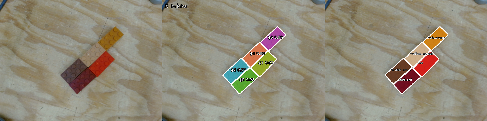
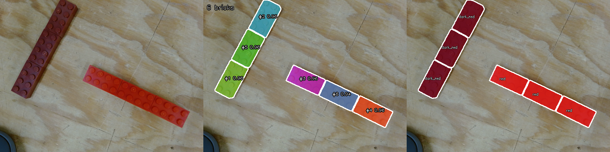
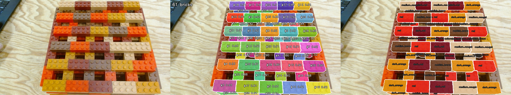
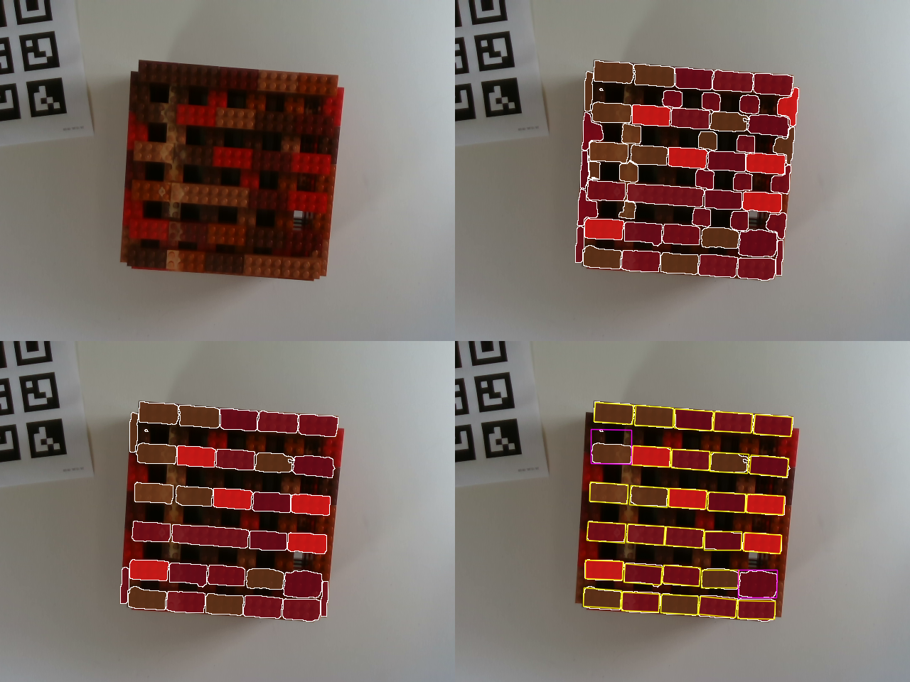

# RGB-D top-layer LEGO detection

The official baseline is [`segment_lego_rgbd_topplane.py`](segment_lego_rgbd_topplane.py), the **top-plane-first V2** detector. It finds visible 2x4 bricks on the highest supported layer and returns an oriented bounding box and camera-frame 3D position for each brick. It deliberately does **not** classify brick colour or quality.

The key design choice is that SAM 3 is evidence, not a hard detection gate. SAM supplies reliable brick-shaped seeds, while aligned depth identifies the physical top plane and a regular LEGO lattice recovers bricks that SAM missed or merged. The complete 69-recording run over `data3` and `data4` is saved in [`results_rgbd_topplane_v2/`](results_rgbd_topplane_v2/).

## Requirements

The baseline was tested with Intel RealSense D435 aligned RGB-D recordings, an NVIDIA RTX 4080 SUPER with CUDA 12.8, Python 3.12.15, PyTorch 2.10.0+cu128, torchvision 0.25.0+cu128, SAM 3 commit `7f473cf`, transformers 5.20.1, OpenCV 4.11.0, NumPy 1.26.4, and Pillow. Gated access to the [`facebook/sam3`](https://huggingface.co/facebook/sam3) weights is required.

Full installation instructions are in the [perception README](../README.md#sam-3-setup). Keep the multi-gigabyte checkpoint on the cache volume:

```bash
HF_HOME=/cache/s95vkond/huggingface \
HF_TOKEN_PATH=/home_domuser2/s95vkond/.cache/huggingface/token
```

## Input layout

```text
extracted/
├── data3/<recording>/
│   ├── camera_info.json
│   ├── rgb/000000.png ...
│   └── depth/000000.png ...
└── data4/<recording>/
    ├── camera_info.json
    ├── rgb/000000.png ...
    └── depth/000000.png ...
```

`camera_info.json` must contain the RGB-aligned depth scale and camera intrinsics used to convert depth pixels into camera-frame XYZ points.

## Current architecture

```text
RGB frame ──> SAM 3 masks ──> rectangular brick seeds ─────────────┐
                                                                   │
Depth frames ─> temporal median ─> XYZ cloud ─> support plane      ├─> active orientation
                                      └──────> height histogram    │   + size calibration
                                                   └─> top plane ──┘
                                                              │
                                     lattice phase + candidate cells
                                                              │
                                    top-plane coverage validation
                                                              │
                                     oriented top boxes + camera XYZ
```

1. **Temporal depth filtering:** a median of nine nearby depth frames suppresses RealSense holes and transient noise.
2. **Support-plane fitting:** RANSAC fits the table plane. Pixel heights are measured relative to it, so camera tilt does not become stack height.
3. **Top-surface extraction:** a 1 mm height histogram proposes planes from highest to lowest. A peak needs sufficient pixel support and overlap with a rectangular LEGO-shaped SAM seed, rejecting high outliers and visible lower layers.
4. **Active-layer geometry:** only masks overlapping the selected plane estimate orientation. This handles the 90-degree rotation between adjacent layers. Normal and rectangular merged masks can support the plane.
5. **Per-dataset calibration:** the first complete scene estimates the projected 2x4 brick dimensions. Reusing them prevents sparse end states from shrinking boxes.
6. **Lattice reconstruction:** seed centres determine the regular LEGO lattice phase. Candidate cells are generated over the whole top surface, not only where SAM produced instances.
7. **Depth validation:** a cell is kept when at least 55% of its oriented rectangle lies on the top plane. This recovers missed bricks, splits merged masks, and rejects irregular or lower-layer regions.

SAM is therefore used to establish brick geometry, while depth is the final evidence for membership in the top layer. A final box is tagged `sam+lattice` when it overlaps SAM evidence and `depth+lattice` when it was recovered primarily from depth.

## Run the official baseline

```bash
cd perception/sam3_detection
HF_HOME=/cache/s95vkond/huggingface \
HF_TOKEN_PATH=/home_domuser2/s95vkond/.cache/huggingface/token \
conda run -n sam3 python segment_lego_rgbd_topplane.py \
  /cache/s95vkond/rgbd_data/extracted/extracted \
  --datasets data3 data4 \
  --out results_rgbd_topplane_v2
```

| Option | Default | Purpose |
|---|---:|---|
| `--temporal-frames` | 9 | depth frames in the temporal median |
| `--plane-threshold-mm` | 4.0 | support-plane RANSAC tolerance |
| `--min-object-height-mm` | 20.0 | ignore geometry close to the table |
| `--height-bin-mm` | 1.0 | height histogram resolution |
| `--top-plane-band-mm` | 2.5 | accepted distance around the selected plane |
| `--min-top-plane-pixels` | 500 | minimum support for a height peak |
| `--seed-min-coverage` | 0.55 | top-plane overlap required from a seed |
| `--orientation-tolerance-deg` | 15 | allowed orientation deviation |
| `--candidate-min-coverage` | 0.55 | top-plane coverage required for a final box |
| `--brick-long-px`, `--brick-short-px` | auto | optional fixed projected brick dimensions |

Use `--recordings <name ...>`, `--max-recordings N`, or `--frame N` for a smaller run.

## Baseline output

Each frame is stored under `<output>/<dataset>/<recording>/<frame>/`:

| File | Content |
|---|---|
| `result.png` | RGB with final oriented top-layer boxes |
| `comparison.png` | original and result side by side |
| `top_boxes.json` | plane and lattice diagnostics, depth sources, rejected SAM masks, box coverage/source, and camera-frame XYZ |

The root also contains `summary.json` and `summary.csv`. Green boxes have SAM and lattice support; yellow boxes were recovered by depth and the lattice.

The saved run covers all 32 `data3` and 37 `data4` recordings, including sparse end states, a single remaining brick, merged masks, and a new-stack reset. The overlays are structurally coherent, but there are no manual ground-truth boxes yet. Measure precision and recall on an annotated validation split before using detections as a robot safety boundary.

Image-space calibration assumes a fixed camera and stack pose within each dataset. Recalibrate after a material camera/viewpoint change. Severe depth holes or a top layer with no usable SAM seed can still prevent reconstruction.

## Separate good/bad classifier

[`classify_top_brick_quality.py`](../../classifier/classify_top_brick_quality.py) is a separate,
CPU-only post-processing stage. It reads the existing `top_boxes.json` files;
it does not run or modify SAM or top-plane segmentation. For each oriented box
it erodes the boundary, removes shadow and highlight pixels, corrects white
balance from the neutral table, measures robust Lab colour, and matches the
brick against the five camera-calibrated colour prototypes. Medium nougat and
reddish brown are `BAD`; red, dark red, and dark orange are `GOOD`.

```bash
python ../../classifier/classify_top_brick_quality.py results_rgbd_topplane_v2 \
  --out ../../classifier/results_rgbd_quality_v1
```

The classifier writes `quality_result.png`, `quality_comparison.png`, and
`quality_boxes.json` for every segmented frame, plus root-level JSON and CSV
summaries. Good boxes are green and bad boxes are red. Confidence, nearest
colour, runner-up colour, Lab measurements, white-balance gains, and all class
distances remain available in JSON for calibration and debugging.

## Preserved earlier RGB-D approaches

Two reproducible RGB-D approaches are retained:

- [`segment_lego_rgbd_baseline.py`](segment_lego_rgbd_baseline.py) freezes the
  original 70th-percentile, global-highest-within-5-mm heuristic. Its original
  69 outputs remain in `results_rgbd_top_boxes/`.
- [`segment_lego_rgbd_improved.py`](segment_lego_rgbd_improved.py) is the
  geometry-only improved approach. It takes a temporal median of aligned depth
  frames, extracts each mask's largest connected planar surface, validates its
  physical 2x4-brick dimensions, clusters surfaces by physical height, and
  returns every brick in the highest supported cluster. It does not impose a
  five-brick or image-row limit and does not classify quality.
- [`segment_lego_rgbd_topplane.py`](segment_lego_rgbd_topplane.py) is the V2
  top-plane-first model. SAM supplies geometric seeds, while depth selects the
  supported upper plane. The model learns the active layer's orientation,
  brick dimensions and lattice, then evaluates every lattice cell by top-plane
  coverage. It can recover missed instances and split merged SAM detections.
  Its 69 outputs are stored in `results_rgbd_topplane_v2/`.

```bash
HF_HOME=/cache/s95vkond/huggingface \
HF_TOKEN_PATH=/home_domuser2/s95vkond/.cache/huggingface/token \
python segment_lego_rgbd_topplane.py \
  /cache/s95vkond/rgbd_data/extracted/extracted \
  --datasets data3 data4 \
  --out results_rgbd_topplane_v2
```

`HF_HOME` keeps the large SAM 3 checkpoint in the cache volume instead of the
home-directory quota. `HF_TOKEN_PATH` reuses the existing gated-model login
without copying credentials. Use the same settings for the other SAM 3 scripts.

The original baseline results remain in `results_rgbd_top_boxes/`, and V1 remains
in `results_rgbd_improved_v1/`. Shared RGB-D utilities are in
[`segment_lego_rgbd.py`](segment_lego_rgbd.py).

## Legacy RGB-only colour classifier

Instance and colour segmentation of 2x4 LEGO bricks, with a good / bad label per brick: [`segment_lego_sam3_single_prompt.py`](segment_lego_sam3_single_prompt.py). For RGB-D recordings of a stack, see [Top layer from depth](#top-layer-from-depth-with-the-brick-size-prior).



*Left: camera RGB. Middle: one mask per brick, with its id and SAM 3 score. Right: each brick filled with its colour class.*

## Prompt

SAM 3 is prompted with a single text prompt:

```
lego brick
```

The prompt only finds the bricks. Each brick's colour class comes from its measured colour, because SAM 3 does not reliably tell close shades apart (red, dark red, reddish brown). The good / bad label follows from the colour class.

## Brick classes

| Class | LEGO element | Quality |
|---|---|---|
| `red` | 300121 | good |
| `dark_red` | 6117418 | good |
| `dark_orange` | 6487946 | good |
| `medium_nougat` | 6135191 | bad |
| `reddish_brown` | 4211201 | bad |

## How it works

1. Run SAM 3 (`facebook/sam3`, via Hugging Face `transformers`) with the prompt and keep detections scoring at least 0.5.
2. Filter the detections:
   - drop a mask when more than half of it is already covered by a higher-scoring mask;
   - drop masks smaller than 300 px;
   - drop masks that are not rectangular (mask area below 0.7 of its minimum-area rectangle);
   - drop slivers smaller than 0.4 of the median brick area, such as parts of lower-layer bricks seen through gaps.
3. Measure each brick's Lab colour inside the mask, away from its edges, shadows and highlights.
4. Match all bricks of an image to the reference colours in `PALETTE` together. A global Lab offset is estimated for the image at the same time, which absorbs white-balance and exposure changes. Bricks still far from every reference colour are rejected.
5. Label each brick good or bad from its colour class.

## Run

Set up the `sam3` environment and Hugging Face access as described in the [perception README](../README.md#sam-3-setup). Then run on a folder of PNGs or a single image:

```bash
python segment_lego_sam3_single_prompt.py path/to/rgb --out results
```

| Option | Default | Effect |
|---|---|---|
| `--prompt` | `lego brick` | text prompt |
| `--threshold` | 0.5 | minimum SAM 3 score |
| `--max-overlap` | 0.5 | drop a mask if this fraction is already covered by better ones |
| `--min-area` | 300 | minimum mask area in pixels |
| `--min-rect` | 0.7 | minimum rectangularity |
| `--min-rel-area` | 0.4 | minimum area as a fraction of the median brick area |
| `--max-colour-dist` | 35 | rejection distance from the nearest reference colour, after the offset |

## Output

One folder per input image `<name>.png`:

| File | Content |
|---|---|
| `semantic.png` | uint8 class per pixel: 0 = background, 1–5 = class in the table above |
| `instance.png` | uint16 brick id per pixel: 0 = background |
| `instances.json` | per brick: id, colour, class id, quality, score, box, area, centroid, minimum-area rectangle (centre, size, angle), rectangularity, `touches_border`, Lab colour, colour distance. Also the image's Lab colour offset and the rejected detections with the reason |
| `preview.png` | input, instances, colour classes side by side |

`summary.json` in the output folder has the brick count per colour and the number of rejected detections per image.

## Results

[`results_single_prompt/`](results_single_prompt/) holds the output for three images from each dataset.

**Test set** (640x480, the five colours the palette was calibrated on): `test_set/`

| Image | Bricks | Good | Bad | Rejected |
|---|---|---|---|---|
| rgb_20261023_164946_396640 | 5 | 3 | 2 | 1 |
| rgb_20261023_165012_439406 | 5 | 3 | 2 | 0 |
| rgb_20261023_165239_744023 | 6 | 6 | 0 | 0 |

All bricks are found and classed correctly, including touching bricks of the same colour:



**Brick stack** (1920x1080, a different camera setup): `stack/`

| Image | Bricks | Good | Bad | Rejected |
|---|---|---|---|---|
| rgb_20261023_185622_491366 | 61 | 35 | 26 | 20 |
| rgb_20261023_185951_544446 | 62 | 34 | 28 | 15 |
| rgb_20261023_190231_851195 | 54 | 27 | 27 | 29 |



The instances are good: in the image above, every top-layer brick is found as one mask. The colour classes are not reliable yet on this camera:

- The estimated colour offset is very large (about +55 in lightness), so the palette does not fit these images.
- The five brick types are grouped consistently, but under the wrong names. Orange comes out as `red`, reddish brown as `dark_red`, and grey-brown as `reddish_brown`. `dark_orange` and `medium_nougat` look right.
- Some slivers of the layer below, visible in the gaps, are still kept. A higher `--min-rel-area` (about 0.6) or `--threshold` (about 0.85) removes most of them.

To fix the colours, recalibrate `PALETTE` on this camera. Take the reference colours from the `lab` field in `instances.json`, with the camera's white balance and exposure fixed.

## Top layer from depth, with the brick-size prior

[`top_layer_bricks.py`](top_layer_bricks.py) finds the individual bricks of the top layer of a stack in RealSense RGB-D recordings, for picking. It uses the segmentation above and adds depth and a prior on the brick size (32 x 16 x 9.6 mm, a LEGO 2x4 without studs).



*Top left: camera RGB. Top right: all SAM 3 bricks, filled with their colour class. Bottom left: the top layer selected from depth. Bottom right: the bricks after the size prior, with the fitted footprint of each brick in yellow.*

### How it works

1. Segment the RGB frame with SAM 3 and the "lego brick" prompt, and give each brick a colour class, as described above.
2. Back-project the depth (aligned to colour) to 3D and fit the table plane with RANSAC to the depth around the bricks.
3. Measure each brick's height above the table (80th percentile of its eroded mask) and keep the bricks within half a brick height of the highest one. This step is in [`top_layer_depth.py`](top_layer_depth.py), which can also be run on its own.
   - The top layer must be supported by `--top-min-support` masks (default 2), so a single noisy high mask cannot hide the real top layer.
   - Exception: the last brick of a layer is alone. A single mask one brick height above the supported layer is still accepted when its depth shows one clean brick: at least 80% valid depth, at least 80% flat surface with at most 3 mm spread, and a 32 x 16 mm footprint measured from its top-surface depth points (not the mask, so visible side walls do not count). `--no-lone-top-brick` disables this.
4. Project each kept mask onto the table plane at its height and measure it in millimetres:
   - about 32 x 16 mm: one brick;
   - about 16 mm wide and n x 32 mm long: n touching bricks merged into one mask, split into n bricks;
   - about 16 mm wide but clearly shorter than 32 mm, or much narrower than 16 mm: a partly hidden brick or a sliver, rejected;
   - anything else: kept and flagged `irregular`.

   Width may reach `--max-width-factor` x 16 mm (default 1.4, i.e. 22.4 mm). Masks wider than that are rejected before the depth step as assemblies. The margin is needed because a raised brick, or a brick on the edge of the stack, is seen with its side walls and measures about 20 mm wide; a mask that also covers part of a brick lying on top of it measures about 24 mm and must be rejected, or it can replace the real top brick.
5. Fit a 32 x 16 mm footprint to each brick and report its grasp pose (below), its yaw on the table and its layer. The centre comes from the brick's top-face pixels (depth within a quarter brick height of its top) when that face is seen as a whole brick (at least 0.85 L x 0.75 W), so visible side walls do not shift it; otherwise from the mask. The angle always comes from the mask outline: on stack frames its error is about a third of an angle fitted to the top-face points.

### Run

The input is one extracted recording folder with `rgb/`, `depth/` (aligned to colour, 16-bit) and `camera_info.json` (with `aligned_depth_intrinsics` and `depth_scale_m`):

```bash
python top_layer_bricks.py path/to/recording --frame 000020
```

A window shows the preview; add `--no-show` to skip it. Without a display the preview is only saved. `--brick-size-mm L W H`, `--size-tol` (default 0.3, i.e. ±30%) and `--max-width-factor` (default 1.4) set the prior; `--top-min-support` and `--no-lone-top-brick` control the top-layer choice. `bricks.json` records `lone_top_brick_accepted` and, per depth instance, `top_footprint_mm`. The pose line of every brick is printed at the end (`--no-print-poses` to skip).

Output in `data/top_layer_bricks/<recording>/<frame>/`:

| File | Content |
|---|---|
| `final_instances.png` | uint16 brick id per pixel after splitting, 0 = background |
| `final_semantic.png` | uint8 colour class per pixel |
| `overlay.png` | top-layer bricks as coloured patches with white boundaries and the fitted footprints (yellow; magenta for `irregular`) |
| `preview.png` | the four panels shown above |
| `bricks.json` | per brick: status (`brick`, `split`, `partial`, `irregular`), colour, quality, measured size, height, layer, top-face centre `centre_cam_m` (m), `angle_img_deg`, `centre_source` (`top_face_depth` or `mask`), `top_face_mm`, yaw on the table, footprint in pixels, and the 3D box in the camera frame (centre, size, rotation, 8 corners) |
| `poses.csv` | one row per brick: box centre `cx, cy, cz`, top-face centre `top_cx, top_cy, top_cz`, `yaw_deg_table`, `angle_img_deg`, `centre_source`, size, and the 8 box corners `c0`–`c7` (top face 0–3, bottom face 4–7), all in the camera frame in metres |

### Grasp pose for the robot

Each brick is printed (and stored) as

```text
#3 reddish_brown bad x=0.108904 y=0.057324 z=0.263015 angle=-87.2
```

- `x y z` (`centre_cam_m`, `top_cx/cy/cz`): centre of the brick's **top face** in
  `camera_color_optical_frame` (x right, y down, z forward out of the lens), metres.
  Depth is aligned to colour and back-projected with the colour intrinsics.
- `angle` (`angle_img_deg`): direction of the brick's long side in the image, in degrees,
  from +x (right) toward +y (down), i.e. clockwise on screen, in (-90, 90]. Only the
  line matters, so a vertical brick can read +90 or about -89.
- Send these numbers unchanged; height bias corrections belong to the robot side.
- `yaw_deg_table` and the rotation/quaternion of the 3D box use a different
  convention (table-plane axes) and are not this angle.
- Keep the camera at least ~28 cm above the top layer; closer, RealSense depth
  becomes unreliable and bricks can lose their depth entirely.

### Results

[`results_top_layer/`](results_top_layer/) holds three frames recorded with a RealSense D435 about 42 cm above the table.

| Recording / frame | Top-layer masks | Bricks | Of which split | Rejected |
|---|---|---|---|---|
| 20261024_095657 / 000020 | 33 | 28 | 7 | 9 |
| 20261024_100345 / 000030 | 21 | 18 | 6 | 7 |
| 20261024_102430 / 000017 | 32 | 30 | 2 | 3 |

- The table plane fits to about 0.9 mm (median residual).
- The size prior fits the data well: single top-layer bricks measure about 31 x 16 mm on the table.
- In `20261024_100345` only the left half of the stack has a top layer, and only those bricks are kept.

Known issues:

- Where SAM 3 returns a top-layer brick only as thin slivers, the size prior rejects it, so that brick is missing (top of the left column in `20261024_095657`).
- The colour palette was calibrated on the webcam images, so the colour names are not reliable on the RealSense yet. The masks and the top-layer selection do not depend on them.

## Live D435 with settings from a Viewer SDK recording

The live script uses the same analysis functions and six-panel visualization as
`top_layer_bricks.py`. SAM3 loads once, and detection runs in a worker while the
live camera continues updating. The positional argument is an **extracted
reference recording** with `camera_info.json` and `recording_settings.json`:

```bash
conda activate sam3
python perception/sam3_detection/live_top_layer_bricks.py \
  data_collection/data/extracted/data4/20261024_095657 \
  --brick-size-mm 32 16 9.6
```

Connect the camera with USB 3 and close RealSense Viewer/other camera programs.
The `sam3` environment needs `pyrealsense2` (installed locally as 2.59.1.11053).
By default the recorded serial number is required; use `--serial SERIAL` for
another camera (its own calibration is read live).

Controls:

- **Enter:** capture a new snapshot and detect its bricks; input is ignored while busy.
- **s:** save the completed snapshot, masks, six-panel preview, `bricks.json`,
  `poses.csv`, RGB, aligned/native uint16 depth, calibration and metadata.
- **q / Escape:** quit. An in-progress GPU inference finishes during shutdown.

Results save under `data/live_top_layer_bricks/session_<timestamp>/<capture>/`.
`rgb/000000.png`, `depth/000000.png` and `camera_info.json` can be passed back to
the offline script. Poses are in the camera frame and refer to the captured
snapshot, not the continually updating live view. Keep the scene stationary
while capturing and do not use old poses after moving the camera/bricks.

Recorded stream dimensions, formats and FPS are restored. Writable imaging
options (preset, emitter/laser power, depth scale, automatic controls and color
controls) are restored from the first recorded settings. Dynamic exposure/gain
and white-balance values are not forced when their auto controls were enabled.
Read-only telemetry, sync outputs and HDR sequence registers are not restored.
The session's `settings_report.json` lists applied/skipped/failed controls.
Failures or unsupported imaging options stop startup by default; review them
before choosing `--allow-setting-differences`. Exact auto-exposure results also
depend on current lighting, and firmware differences can affect settings.

Recordings list post-processing block names without complete enabled states and
parameters. No Viewer software filters are applied: this matches our offline
extraction (original depth plus alignment). Advanced custom preset registers
cannot be fully recovered from those option topics. If you used them, export
camera settings JSON from Viewer and pass `--advanced-json settings.json`;
its preset is retained while the other recorded imaging controls are applied.

The default `--burst 1` reproduces single-frame offline input. Optional
`--burst 10` takes a valid-pixel median of aligned and native depth over ten
frames, with the middle color frame; use only with a stationary camera/scene.
Zero remains missing depth, and the source depth scale converts pixels to metres.
