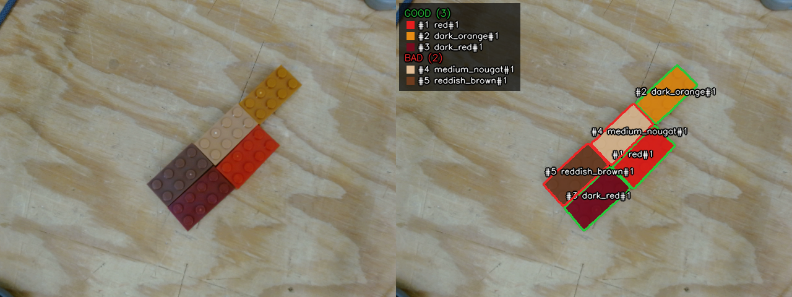

# SAM 3 LEGO brick detection

Instance and colour segmentation of 2x4 LEGO bricks on the work table, with a good / bad label per brick.



*Left: camera RGB. Right: one mask per brick, filled with its colour class. Outlines are green for good bricks and red for bad ones. The box lists the good and bad bricks in the image.*

## Brick classes

| Class | LEGO element | Quality |
|---|---|---|
| `red` | 300121 | good |
| `dark_red` | 6117418 | good |
| `dark_orange` | 6487946 | good |
| `medium_nougat` | 6135191 | bad |
| `reddish_brown` | 4211201 | bad |

## Prompts

SAM 3 runs once per text prompt. The detections from all prompts are merged, and duplicates are removed.

```
red lego brick
dark red lego brick
orange lego brick
beige lego brick
brown lego brick
lego brick
```

The text prompts only find bricks. Each brick's colour class comes from its measured colour: the median Lab colour of the mask is matched to the nearest reference colour in `PALETTE`. SAM 3 alone does not reliably tell red, dark red and reddish brown apart. The good / bad label follows directly from the colour class.

## How it works

1. Run SAM 3 (`facebook/sam3`, via Hugging Face `transformers`) with each prompt and keep detections scoring at least 0.6.
2. Merge the detections. A mask is dropped when more than half of it is already covered by a higher-scoring mask. This removes masks that cover a whole row of touching bricks.
3. Give each brick a colour class from its Lab colour. The colour is measured inside the mask, away from its edges, highlights and shadows. Masks whose colour is far from every reference colour are rejected as non-LEGO objects, such as the cable.
4. Label each brick good or bad from its colour class.

## Run

Set up the `sam3` environment and Hugging Face access as described in the [perception README](../README.md#sam-3-setup). Then run:

```bash
python segment_lego_sam3.py path/to/rgb --out results
```

Options: `--prompts` (replaces the prompt list), `--threshold` (minimum score, default 0.6), `--max-colour-dist` (rejection distance, default 35).

## Output

One folder per input image `<name>.png`:

| File | Content |
|---|---|
| `semantic.png` | uint8 class per pixel: 0 = background, 1–5 = class in the table above |
| `instance.png` | uint16 brick id per pixel: 0 = background |
| `instances.json` | per brick: id, colour, quality, prompt that found it, score, box, area, centroid, `touches_border`, Lab colour |
| `preview.png` | split view: input on the left, result and good / bad legend on the right |

`results/summary.json` has the brick, good and bad counts per image.

## Results on the 14 test images

| Image | Bricks | Good | Bad |
|---|---|---|---|
| rgb_20261023_164838_598500 | 1 | 0 | 1 |
| rgb_20261023_164850_937565 | 2 | 1 | 1 |
| rgb_20261023_164909_961059 | 3 | 2 | 1 |
| rgb_20261023_164917_335531 | 4 | 3 | 1 |
| rgb_20261023_164943_825011 | 5 | 3 | 2 |
| rgb_20261023_164946_396640 | 5 | 3 | 2 |
| rgb_20261023_165012_439406 | 5 | 3 | 2 |
| rgb_20261023_165040_935110 | 4 | 3 | 1 |
| rgb_20261023_165109_422686 | 3 | 3 | 0 |
| rgb_20261023_165145_106610 | 3 | 3 | 0 |
| rgb_20261023_165156_532105 | 3 | 3 | 0 |
| rgb_20261023_165217_211643 | 3 | 3 | 0 |
| rgb_20261023_165235_857201 | 6 | 6 | 0 |
| rgb_20261023_165239_744023 | 6 | 6 | 0 |

Known issue: in `rgb_20261023_165040_935110` a brick that is almost entirely outside the frame (top-left corner) is labelled `dark_orange`, but it is probably `medium_nougat`. Too little of it is visible to measure its colour. The `touches_border` field in `instances.json` flags such bricks.
