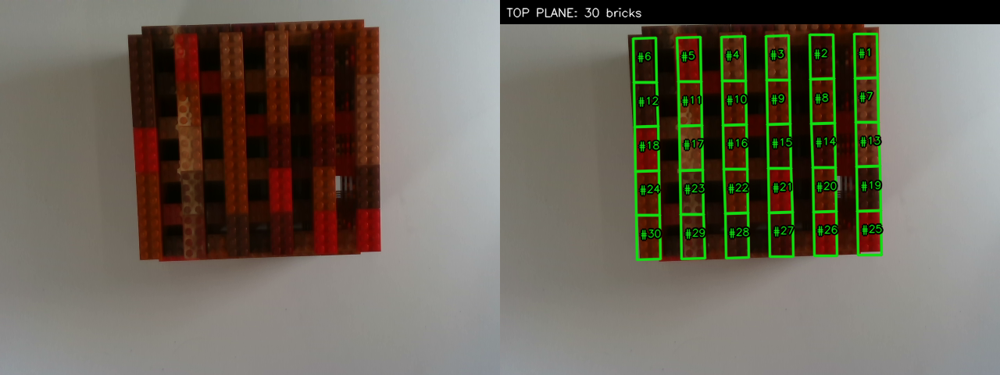
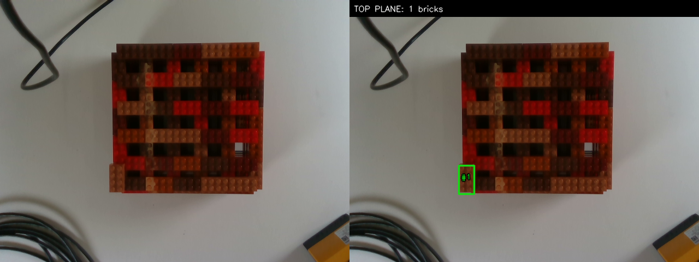

# SAM 3 RGB-D top-layer bounding-box segmentation

This folder contains the standalone baseline used to detect the exposed top
layer of a LEGO stack and return one oriented bounding box per visible 2x4
brick. It performs segmentation and geometry only; good/bad classification is
the separate downstream stage in [`../classifier/`](../classifier/).

The official entry point is
[`segment_lego_rgbd_topplane.py`](segment_lego_rgbd_topplane.py). SAM 3 is used
as geometric evidence rather than as the final instance detector. Aligned depth
selects the physical top surface, and a regular LEGO lattice recovers instances
that SAM missed or merged.

## Inputs and requirements

The baseline was developed for aligned RGB-D recordings from an Intel RealSense
D435. The tested environment was:

- NVIDIA RTX 4080 SUPER with CUDA 12.8;
- Python 3.12.15;
- PyTorch 2.10.0+cu128 and torchvision 0.25.0+cu128;
- SAM 3 commit `7f473cf`;
- transformers 5.20.1;
- OpenCV 4.11.0, NumPy 1.26.4, and Pillow;
- gated access to the `facebook/sam3` Hugging Face model.

Keep the multi-gigabyte model weights on the cache volume:

```bash
HF_HOME=/cache/s95vkond/huggingface \
HF_TOKEN_PATH=/home_domuser2/s95vkond/.cache/huggingface/token
```

Expected recording layout:

```text
<input-root>/
├── data3/
│   └── <recording>/
│       ├── camera_info.json
│       ├── rgb/000000.png ...
│       └── depth/000000.png ...
└── data4/
    └── <recording>/
        ├── camera_info.json
        ├── rgb/000000.png ...
        └── depth/000000.png ...
```

`camera_info.json` supplies the aligned colour-camera intrinsics, depth scale,
invalid-depth value, and camera metadata.

## Model architecture

```text
RGB frame ──> SAM 3 prompt: "lego brick" ──> instance masks
                                                   │
                                      rectangular geometric seeds
                                                   │
Depth sequence ─> temporal median ─> XYZ point cloud
                                           │
                                  RANSAC support plane
                                           │
                            height-above-support histogram
                                           │
                 highest supported peak overlapping a LEGO seed
                                           │
                              physical top-surface pixel mask
                                           │
SAM seeds + top surface ─> orientation and size calibration
                                           │
                              regular LEGO lattice phase
                                           │
                         evaluate every candidate lattice cell
                                           │
                       oriented top-layer bounding boxes + XYZ
```

### 1. SAM 3 geometric seeds

SAM 3 receives the text prompt `lego brick`. Masks are filtered for minimum
area, overlap, rectangularity, and approximately 2x4-brick aspect ratio. Wider
rectangular masks are retained as plane evidence because SAM can merge touching
bricks. SAM is not a hard gate for the final boxes.

### 2. Temporal depth filtering

Nine aligned depth frames are combined with a per-pixel median. This suppresses
RealSense holes and transient depth noise while preserving the static stack.
The aligned intrinsics convert every valid depth pixel into camera-frame XYZ.

### 3. Support plane and physical height

RANSAC fits the table/support plane outside the detected brick regions. Height
is measured along the plane normal rather than directly along camera Z, so a
small camera tilt does not become a false stack-height gradient.

### 4. Strong top-surface extraction

Elevated pixels are placed in a 1 mm height histogram. Candidate peaks are
tested from highest to lowest. A peak becomes the top plane only when:

- it contains at least the configured number of depth pixels;
- its pixels lie within the 2.5 mm plane band; and
- it overlaps a rectangular LEGO-shaped SAM seed sufficiently.

This rejects isolated high-depth noise and visible portions of lower layers.
The method does not assume exactly five bricks per layer.

### 5. Active-layer orientation and size calibration

Only masks overlapping the selected physical plane estimate orientation. This
prevents lower-layer masks from corrupting the result and handles the 90-degree
rotation between adjacent LEGO layers. The first complete scene calibrates the
projected long and short dimensions; subsequent sparse scenes reuse them.

### 6. Lattice reconstruction

Reliable seed centres determine the phase of the regular projected LEGO
lattice. Candidate rectangles are generated over the complete top-plane extent,
including cells without a SAM instance. This is how the baseline:

- recovers bricks that SAM missed;
- splits a SAM mask spanning several touching bricks; and
- continues working when only one brick remains.

### 7. Final bounding-box validation

Every oriented candidate must have at least 55% coverage by selected top-plane
pixels. Accepted boxes store their pixel centre, four oriented pixel corners,
top-plane coverage, SAM overlap, source (`sam+lattice` or `depth+lattice`), and
the median camera-frame XYZ of their supported depth pixels.

## Run

From the repository root:

```bash
HF_HOME=/cache/s95vkond/huggingface \
HF_TOKEN_PATH=/home_domuser2/s95vkond/.cache/huggingface/token \
conda run -n sam3 python \
  segmentation_sam3_bounding_box/segment_lego_rgbd_topplane.py \
  /cache/s95vkond/rgbd_data/extracted/extracted \
  --datasets data3 data4 \
  --out segmentation_sam3_bounding_box/results_rgbd_topplane_v2
```

Important parameters:

| Option | Default | Purpose |
|---|---:|---|
| `--temporal-frames` | 9 | frames in the depth median |
| `--plane-threshold-mm` | 4.0 | RANSAC support-plane tolerance |
| `--min-object-height-mm` | 20.0 | reject geometry close to the table |
| `--height-bin-mm` | 1.0 | height histogram resolution |
| `--top-plane-band-mm` | 2.5 | accepted distance around the top height |
| `--min-top-plane-pixels` | 500 | required support for a height peak |
| `--seed-min-coverage` | 0.55 | seed overlap with the top plane |
| `--orientation-tolerance-deg` | 15 | allowed orientation deviation |
| `--candidate-min-coverage` | 0.55 | required final top-plane coverage |

Use `--recordings <name ...>`, `--max-recordings N`, or `--frame N` for a
smaller validation run.

## Output

Each `<output>/<dataset>/<recording>/<frame>/` folder contains:

| File | Content |
|---|---|
| `result.png` | RGB image with oriented top-layer boxes |
| `comparison.png` | original RGB and result side by side |
| `top_boxes.json` | plane diagnostics, lattice calibration, depth sources, rejected SAM masks, and final boxes |

The output root also contains `summary.json` and `summary.csv` with the SAM and
final top-layer counts for every recording.

The `position_camera_m` field is ordered `[x, y, z]` in metres using the
RealSense optical convention: +x right, +y down, +z forward. The downstream
pose exporter in `classifier/` converts the fitted centre and complete cuboid
corners into explicit camera-coordinate metadata.

## Examples

Dense top layer:



Single remaining top brick:



## Files in this package

- `segment_lego_rgbd_topplane.py`: official top-plane-first baseline;
- `segment_lego_rgbd.py`: RGB-D loading, temporal filtering, XYZ conversion,
  support-plane fitting, and shared geometry utilities;
- `segment_lego_sam3_single_prompt.py`: reusable SAM 3 model loading and
  geometry-mask interface required by the baseline;
- `examples/`: representative saved results.

## Limitations

The image-space lattice calibration assumes a fixed camera and stack pose for a
dataset. Significant viewpoint changes require recalibration. Severe depth
holes or a scene with no usable LEGO-shaped SAM seed can prevent reconstruction.
The saved recordings do not contain a hand-eye transform, so metric positions
are in the camera frame and are not robot-base coordinates.
